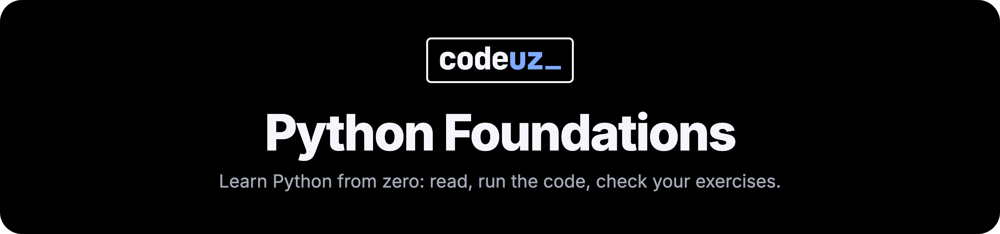

# Python Foundations

A Python course in English and Uzbek. Most examples run in the browser. Lessons mark the examples that need a local Python installation. For programming videos in Uzbek, see the [codeuz](https://youtube.com/codeuz) YouTube channel.

**[Özbekça](https://codeuz-edu.github.io/python-tutorials/uz/)** · **[English](https://codeuz-edu.github.io/python-tutorials/en/)**

Start with twelve modules on the language, files, classes, and testing. Working with Data follows with pandas and Matplotlib. The next step after it is [Advanced Python](https://codeuz-edu.github.io/python-advanced/).

## Run locally

Requires Node.js 22+.

```sh
npm ci
npm run dev
```

## License

[MIT](LICENSE)
